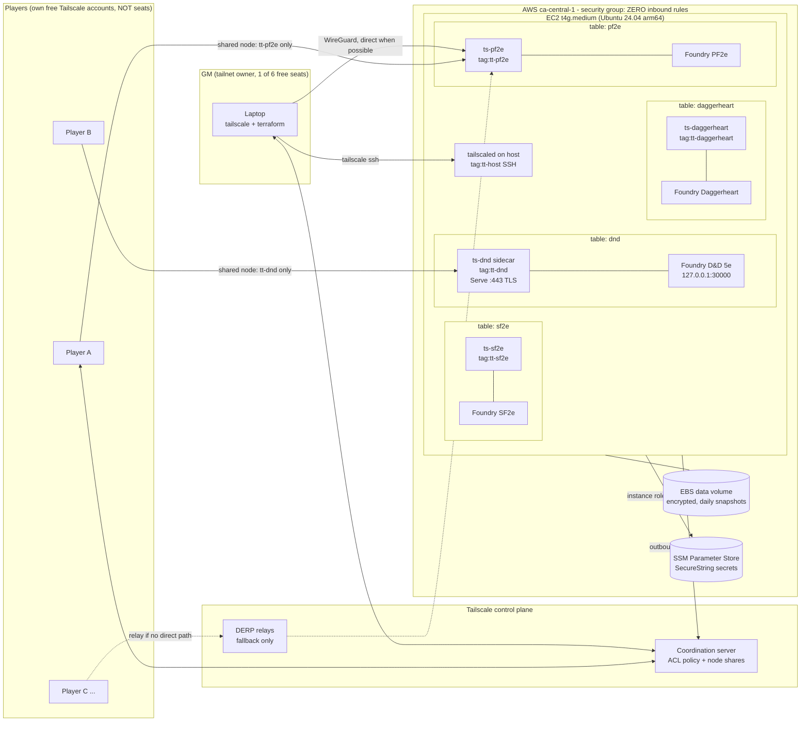
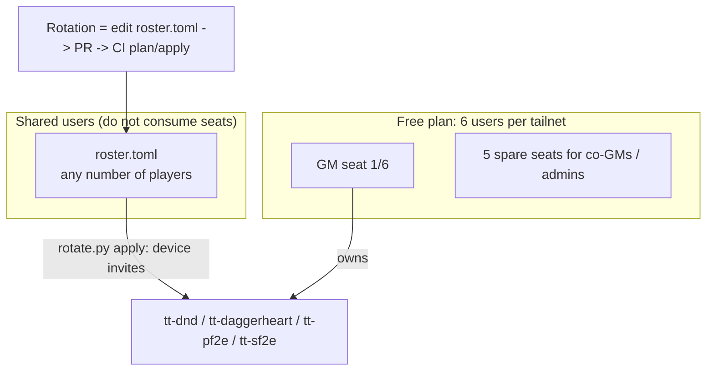

# Architecture

## Components and trust boundaries

## How a request flows

1. A player opens `https://tt-pf2e.<tailnet>.ts.net` in a browser. MagicDNS resolves it to the node's `100.x` address (only because the node was *shared* with that player).
2. Their Tailscale client builds a WireGuard tunnel to the `ts-pf2e` sidecar. NAT traversal usually yields a direct UDP path; otherwise packets ride a DERP relay (still end-to-end encrypted; DERP only sees ciphertext).
3. The sidecar's ACL check passes only if the policy allows that source to `tag:tt-pf2e:443`.
4. **Tailscale Serve** terminates TLS with a Let's Encrypt certificate for the node's `*.ts.net` name and proxies to `127.0.0.1:30000`.
5. `foundry-pf2e` shares the sidecar's network namespace (`network_mode: service:ts-pf2e`), so it receives the request on loopback. Foundry publishes **no** port on the host, and the host's security group has **no** inbound rule, so there is nothing else to connect to.

## Access control, in layers

| Layer | Control | What it stops |
|---|---|---|
| AWS | Security group with no inbound rules; IMDSv2 only, hop limit 1 | Internet scanning, SSRF-style credential theft from containers |
| Tailscale ACL | `autogroup:shared` -> `tag:tt-*:443` only; no tag-to-tag rules | A compromised module on one table reaching another table or the host |
| Tailscale share | One node shared to one named person | A player seeing tables they were not invited to |
| ACL `tests` | Run on every `terraform apply` | A policy edit that silently opens something up |
| Tailscale SSH | `src = admin_email`, `dst = tag:tt-host` | Key sprawl; port 22 never opens |
| Foundry | One license key per accessible table | License violations (enforced by `tabletop open`) |

## The 6-seat problem and how rotation avoids it

- **Inviting** someone to the tailnet gives them access to a whole tailnet and uses a seat.
- **Sharing a node** gives a person on *another* tailnet access to just that node and uses no seat on yours.
- Therefore: players sign up for their own free Tailscale account; the roster decides which nodes are shared with them; `rotate.py seats` and the CI job audit that member seats stay at or below 6.

## Data and recovery

- `/data` (EBS, encrypted) holds Foundry worlds/assets and each sidecar's Tailscale identity, so replacing the instance (`terraform apply` after a cloud-init change) keeps node names, certificates and shares.
- AWS Data Lifecycle Manager takes a daily snapshot and keeps seven.
- Secrets are re-fetched from SSM at every boot; rotating a Foundry password is `terraform apply` plus a reboot.
